  

  
  
  
  
  
  
  
  

---

# 🚀 Awesome LLM On Consumer Hardware

> **A curated showcase of premier SaaS desktop tools, inference engines, quantization frameworks, and open-source software for running Large Language Models (LLMs) locally on consumer-grade hardware.**

Run state-of-the-art models like **Llama 3.3**, **DeepSeek-R1**, **Qwen 2.5**, **Mistral**, **Gemma 2**, and **Phi-4** on everyday laptops, MacBooks (Apple Silicon M1/M2/M3/M4), custom desktop PCs, NVIDIA RTX GPUs, AMD Radeon GPUs, and edge computing boards — **100% offline, private, zero subscription cost, and zero cloud API latency.**

---

### 🔍 Quick Index & Navigation
- [🌐 Sector Overview & Market Dynamics](#-sector-overview--market-dynamics)
- [💼 SaaS & Commercial Desktop Platforms](#-saas--commercial-desktop-platforms)
- [💻 Top Open-Source Projects & Engines](#-top-open-source-projects--engines)
- [📊 VRAM & Hardware Cheatsheet](#-vram--hardware-cheatsheet)
- [📈 Star History](#-star-history)
- [💖 Support & Sponsorship](#-support--sponsorship)
- [🤝 How to Contribute](#-how-to-contribute)
- [⚠️ Disclaimer](#️-disclaimer)

---

## 🌐 Sector Overview & Market Dynamics

The global **Edge AI and On-Device LLM Inference market** was valued at approximately **$15.6 Billion in 2024** and is projected to surpass **$60.4 Billion by 2030**, expanding at a compound annual growth rate (**CAGR**) of **25.8%**, fueled by heightened privacy regulations, rising enterprise cloud token bills, and widespread consumer access to unified memory architectures and neural processing units (NPUs).

The software ecosystem remains **moderately-to-highly fragmented**: while the underlying computing silicon is anchored by an oligopoly (NVIDIA, Apple, AMD, Qualcomm, and Intel), the runtime, server, and GUI layers are driven by a diverse, rapidly evolving mix of grassroots open-source projects (`llama.cpp`, `Ollama`, `vLLM`) and venture-backed desktop interfaces (`LM Studio`, `Jan`, `Msty`, `AnythingLLM`), with no single winner-take-all monopoly established.

---

## 💼 SaaS & Commercial Desktop Platforms

Below is a breakdown of commercial and hybrid SaaS platforms designed for local model execution. Sorted descending by **Company Valuation / Estimated Market Cap**.

| 🖥️ Platform | 🏢 Operating Company | 💰 Valuation / Revenue | 🏷️ Starting Paid Pricing | 🎁 Free Tier Limit | 🎯 Core Focus |
|:---|:---|:---|:---|:---|:---|
| **[NVIDIA ChatRTX](https://www.nvidia.com/en-us/ai-on-rtx/chatrtx/)** | NVIDIA Corporation | **$3.2 Trillion** market cap ($60.9B+ annual revenue) | **$0** (Free bundled software); Enterprise AI support starts at **$4,500/GPU/year** | **Free forever** for RTX 30/40 Series owners (min 8GB VRAM); unlimited offline document & video search | Local TensorRT-LLM accelerated RAG on GeForce hardware |
| **[Pieces for Developers](https://pieces.app/)** | Mesh Intelligent Technologies, Inc. | **$35 Million** valuation ($14.5M venture funding) | **$8/month** (Pro plan billed annually at $72/yr); Enterprise at **$15/user/month** | **Free forever** with local on-device small LLM runtime, unlimited code snippets, and single-device local context | On-device contextual copilot for developers & offline snippet search |
| **[AnythingLLM Cloud](https://anythingllm.com/)** | Mintplex Labs, Inc. | **$12 Million** valuation (Seed-backed) | **$20/month** (Solo Cloud instance); Team Cloud starts at **$99/month** | **Free forever desktop edition** (macOS, Windows, Linux) with unlimited local document embeddings and zero token limits | Enterprise-ready local multi-user RAG & workspace desktop app |
| **[LM Studio](https://lmstudio.ai/)** | Element Labs, Inc. | **$10 Million** valuation (~$2M-$3M ARR) | **$20/user/month** (LM Studio for Work); Free for non-commercial use | **Free forever for personal use** with unlimited GGUF model downloads, offline chat, and local OpenAI server (port 1234) | Polished consumer GUI for downloading and hosting GGUF models |
| **[Faraday.dev](https://faraday.dev/)** | Faraday AI Inc. | **$8 Million** valuation (Seed funded) | **$10/month** (or $96/year for VIP Cloud Sync); Desktop runtime is free | **Free forever desktop edition** with unlimited 2-bit to 8-bit GGUF model inference, unlimited local characters, and 0 telemetry | 100% offline private local AI companion & character chat |
| **[Jan Enterprise](https://jan.ai/)** | Jan Technologies / Menlovate | **$7 Million** valuation (Seed stage) | **$15/user/month** (Jan Team / Enterprise deployment & support) | **Free forever open-source desktop app** (AGPLv3) with unlimited offline chats, local model downloads, and zero telemetry | Privacy-first local ChatGPT alternative running on llama.cpp |
| **[Msty](https://msty.app/)** | Msty AI Inc. | **$5 Million** valuation (Indie venture) | **$4.99/month** (or $49/year, $99 lifetime license for Msty Pro) | **Free forever tier** with unlimited local single-model chats, local knowledge stacks up to 5 documents per stack | Beautiful desktop client with multi-model split view and local RAG |

---

## 💻 Top Open-Source Projects & Engines

The following open-source repositories power the entire on-device and consumer hardware inference ecosystem. **Sorted descending by GitHub Stars_Count** ⭐.

1. **[Ollama](https://github.com/ollama/ollama)**   
   🦙 The de facto standard CLI and background daemon for running LLMs locally. Pull, run, and manage models with single commands (`ollama run llama3.3`). Exposes a local OpenAI-compatible endpoint at `http://localhost:11434`. Accelerates models with CUDA, ROCm, and Apple Metal.

2. **[Open WebUI](https://github.com/open-webui/open-webui)**   
   🌐 Feature-complete, self-hosted web UI designed for Ollama and OpenAI-compatible APIs. Includes multi-user management, prompt pipelines, web search integration, RAG document chats, and fine-grained inference controls.

3. **[llama.cpp](https://github.com/ggml-org/llama.cpp)**   
   ⚡ The foundational C/C++ inference engine pioneered by Georgi Gerganov. Invented the GGUF quantization standard, delivering blistering performance with zero external dependencies on Apple Silicon, NVIDIA GPUs, AMD GPUs, and x86/ARM CPUs.

4. **[vLLM](https://github.com/vllm-project/vllm)**   
   🚀 High-throughput and memory-efficient LLM serving engine featuring PagedAttention. Unlocks maximum token-per-second generation on consumer GPUs like the RTX 3090, 4080, and 4090 with AWQ, GPTQ, and FP8 support.

5. **[LobeChat](https://github.com/lobehub/lobe-chat)**   
   🎨 Modern, open-source chat client framework with a rich plugin marketplace, text-to-speech, multimodal capabilities, and seamless pairing with local Ollama backends.

6. **[GPT4All](https://github.com/nomic-ai/gpt4all)**   
   📦 Privacy-focused consumer ecosystem featuring a desktop application and cross-platform Python bindings. Allows local document Q&A (LocalDocs) with curated, verified open-weights models.

7. **[AnythingLLM](https://github.com/Mintplex-Labs/anything-llm)**   
   📂 All-in-one local LLM assistant desktop app and Docker container with built-in vector database (LanceDB), multi-modal parsing, and workspace separation for complete offline document interrogation.

8. **[LocalAI](https://github.com/mudler/LocalAI)**   
   🔄 Drop-in local replacement for the OpenAI REST API. Acts as an orchestration proxy that unifies LLMs, voice synthesis, audio transcription (Whisper), and image generation under a single self-hosted server.

9. **[Exo](https://github.com/exo-explore/exo)**   
   🔗 Distributed peer-to-peer cluster engine that splits large language models across multiple everyday devices (combining iPhones, MacBooks, and PCs over Wi-Fi) to run 70B+ parameter models collaboratively.

10. **[text-generation-webui](https://github.com/oobabooga/text-generation-webui)**   
    🎛️ The "AUTOMATIC1111 of text generation." A comprehensive Gradio interface supporting multiple backends (Transformers, llama.cpp, ExLlamaV2, AutoGPTQ) with parameter tweaking, LoRA training, and extensions.

11. **[Jan](https://github.com/janhq/jan)**   
    🛡️ Open-source, offline-first ChatGPT alternative for Mac, Windows, and Linux. Built on Electron and llama.cpp, providing localized data storage, custom assistants, and an embedded proxy server.

12. **[SGLang](https://github.com/sgl-project/sglang)**   
    🏎️ High-performance structured execution framework that accelerates complex LLM workflows (multi-turn, tool-calling, agent loops) with RadixAttention and fast KV cache reuse.

13. **[SillyTavern](https://github.com/SillyTavern/SillyTavern)**   
    🎭 Power-user UI specializing in roleplay, immersive storytelling, and character card management. Interfaces with KoboldCpp, Ollama, and text-generation-webui.

14. **[Tabby](https://github.com/TabbyML/tabby)**   
    💻 Self-hosted GitHub Copilot alternative running locally on consumer hardware. Connects directly to VS Code and IntelliJ with low-latency inline code suggestions.

15. **[Stanford Alpaca](https://github.com/tatsu-lab/stanford_alpaca)**   
    🎓 Groundbreaking Stanford instruction-following research project that demonstrated capable 7B LLMs could be fine-tuned and executed cost-effectively on consumer hardware.

16. **[llamafile](https://github.com/mozilla-ai/llamafile)**   
    📁 Single-file multi-OS executable format developed with Cosmopolitan Libc. Embeds quantized model weights and the inference engine into a single cross-platform executable file.

17. **[MLC LLM](https://github.com/mlc-ai/mlc-llm)**   
    📱 Universal machine learning compilation engine utilizing Apache TVM. Compiles LLMs into native binaries for iOS, Android, WebGPU (in-browser), and edge accelerators.

18. **[Candle](https://github.com/huggingface/candle)**   
    🦀 Minimalist, lightweight Rust ML framework from Hugging Face designed for serverless, embedded, and resource-constrained edge deployments with zero Python dependencies.

19. **[KTransformers](https://github.com/kvcache-ai/ktransformers)**   
    🧠 Breakthrough flexible framework that allows running gigantic models (like DeepSeek-V2/V3 236B and MoE architectures) on a single 24GB consumer GPU via advanced CPU offloading and Marlin kernels.

20. **[OpenLLM](https://github.com/bentoml/OpenLLM)**   
    🍱 BentoML's open platform for operating LLMs in production or local development, supporting quantization, multi-backend serving, and containerization.

21. **[KoboldCpp](https://github.com/LostRuins/koboldcpp)**   
    🎲 Single-file executable providing an easy-to-use web interface and API for GGUF models. Very popular for narrative generation, creative writing, and text games.

22. **[Text Generation Inference (TGI)](https://github.com/huggingface/text-generation-inference)**   
    🤗 Hugging Face's high-performance inference engine for popular open-weights models, supporting continuous batching, streaming, and Flash Attention.

23. **[aichat](https://github.com/sigoden/aichat)**   
    ⌨️ Lightning-fast terminal CLI and REPL client written in Rust that supports local Ollama models, shell assistant execution, and multi-model switching.

24. **[PowerInfer](https://github.com/Tiiny-AI/PowerInfer)**   
    ⚡ CPU/GPU hybrid inference engine that leverages neuron activation sparsity to achieve up to an 11x speedup over standard runtimes on consumer GPUs with limited VRAM.

25. **[mlx-examples / mlx-lm](https://github.com/ml-explore/mlx-examples)**   
    🍏 Apple's official open-source machine learning framework specifically engineered to exploit unified memory architectures on Apple Silicon (M1/M2/M3/M4 chips).

26. **[ExLlamaV2](https://github.com/turboderp-org/exllamav2)**   
    🏎️ Ultra-optimized GPU inference engine specializing in the EXL2 format. Delivers maximum generation speeds and flexible fractional bitrates (e.g., 2.2 to 8.0 bpw) on NVIDIA consumer cards.

27. **[oterm](https://github.com/ggozad/oterm)**   
    📟 Beautiful terminal-based Text User Interface (TUI) client for Ollama, allowing keyboard-driven interactions and offline conversation persistence in the terminal.

28. **[BionicGPT](https://github.com/bionic-gpt/bionic-gpt)**   
    🏢 Self-hosted privacy platform designed for teams, delivering role-based access control, local document ingestion, and enterprise single sign-on over local models.

29. **[Aphrodite Engine](https://github.com/aphrodite-engine/aphrodite-engine)**   
    🔮 High-speed LLM inference server based on vLLM and HuggingFace, engineered specifically for creative writers, roleplay communities, and multi-user local deployments.

---

## 📊 VRAM & Hardware Cheatsheet

Understanding memory constraints is crucial when running models locally. Below is a practical guide for model sizing versus hardware capabilities:

| 🏷️ Model Parameters | 💾 Quantization Level | 🧮 Minimum VRAM / RAM | 💻 Recommended Hardware |
|:---|:---|:---|:---|
| **1B – 3B** *(Llama 3.2 1B/3B, Gemma 2 2B)* | Q4_K_M (4-bit) | **2 GB – 4 GB** | Raspberry Pi 5 (8GB), Mini PCs, Intel/AMD iGPU |
| **7B – 8B** *(Llama 3.1 8B, Qwen 2.5 7B, Mistral 7B)* | Q4_K_M (4-bit) | **6 GB – 8 GB** | RTX 3060 (12GB), RTX 4060, Apple Silicon M1/M2/M3 (16GB RAM) |
| **14B** *(Qwen 2.5 14B, DeepSeek-R1-Distill 14B)* | Q4_K_M (4-bit) | **10 GB – 12 GB** | RTX 3060 (12GB), RTX 4070 (12GB), Apple M-Series (18GB+ RAM) |
| **32B** *(Qwen 2.5 32B, DeepSeek-R1-Distill 32B)* | Q4_K_M (4-bit) | **20 GB – 24 GB** | RTX 3090 (24GB), RTX 4090 (24GB), Apple M-Series (36GB+ RAM) |
| **70B** *(Llama 3.3 70B, Qwen 2.5 72B)* | Q4_K_M (4-bit) | **40 GB – 48 GB** | 2x RTX 3090/4090, Apple Silicon Mac Studio (64GB–128GB Unified Memory) |
| **MoE (Mixtral 8x7B, DeepSeek 236B)** | Q4 / KTransformers | **24 GB VRAM + 64GB RAM** | RTX 3090/4090 + High-speed DDR5 RAM with KTransformers offload |

---

## 📈 Star History

---

## 💖 Support & Sponsorship

Thank you so much for exploring and supporting **Awesome-LLM-On-Consumer-Hardware**! ❤️

Maintaining and keeping this ecosystem directory updated with the latest inference breakthroughs, quantization formats, and hardware benchmarks requires dedicated effort. If you find this repository valuable, please consider:
- ⭐ **Starring** the repository on GitHub to boost discoverability.
- 🍴 **Forking** and submitting pull requests with new tools and benchmark updates.
- 📢 **Sharing** this repository with fellow local AI builders, researchers, and offline privacy advocates.
- ☕ **Sponsoring a coffee** to support continued open-source development:

  

---

## 🤝 How to Contribute

Contributions from the community are warmly welcomed! To contribute:
1. 🍴 Fork the repository.
2. 📝 Add or update an entry in [`README.md`](README.md).
3. 📋 Ensure entries adhere to alphabetical or rank ordering, include working URLs, factual descriptions, and transparent pricing/open-source badges.
4. 🚀 Submit a Pull Request with a succinct explanation of the addition.

---

## ⚠️ Disclaimer

- This is a community-maintained curated index, not an endorsement of any particular product or developer.
- Running models locally generates substantial thermal and memory loads. Verify your cooling and power supplies when doing intensive long-context generation or multi-GPU offloading.
- Output quality is heavily dependent on quantization method and precision level; benchmark models on your hardware before standardizing in production.

---

  Built with ❤️ for the open-source and local AI community. Distributed under the MIT License.

